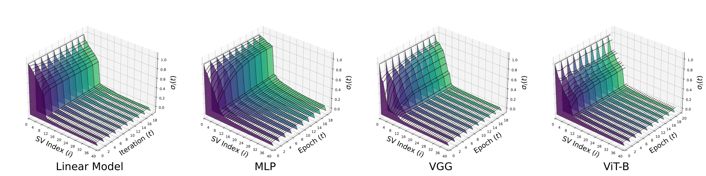

# An Overview of Low-Rank Structures in the Training and Adaptation of Large Models

This is the official repository to reproduce the results in the paper.

## Singular Value Plots for Large Models

The code to reproduce Figures 1, 9 and 11 is available in the folder `SPM-LowRankDeepLearning/get_large_model_svals`  

## Masked Training

The code to reproduce Figures ...
