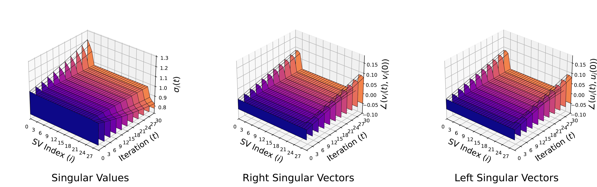
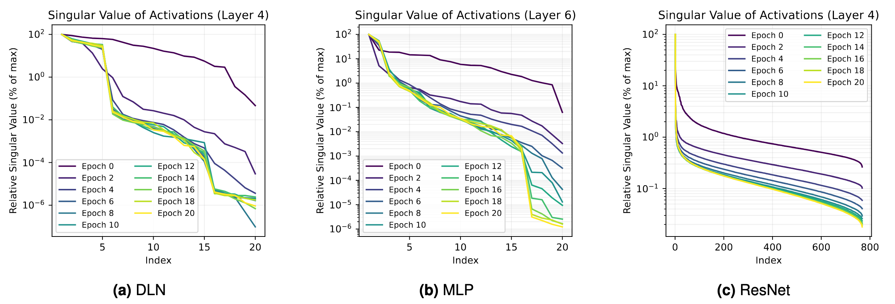
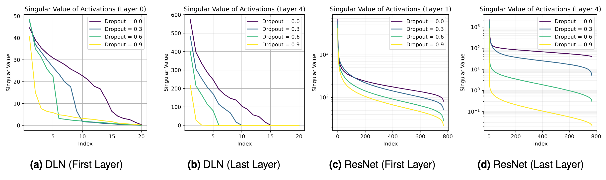

# An Overview of Low-Rank Structures in the Training and Adaptation of Large Models

This is the official repository to reproduce the results in the paper.

## Low-Dimensional Subspace Results

The code to reproduce Figures 4, 5 and 7 is available in the folder `low_dim_subspace`.

## Singular Value Plots for Large Models

The code to reproduce Figures 1, 9 and 11 is available in the folder `get_large_model_svals`  

## Masked Training

The code to reproduce Figures 3 and 10 is available in the folder `masked_training`.